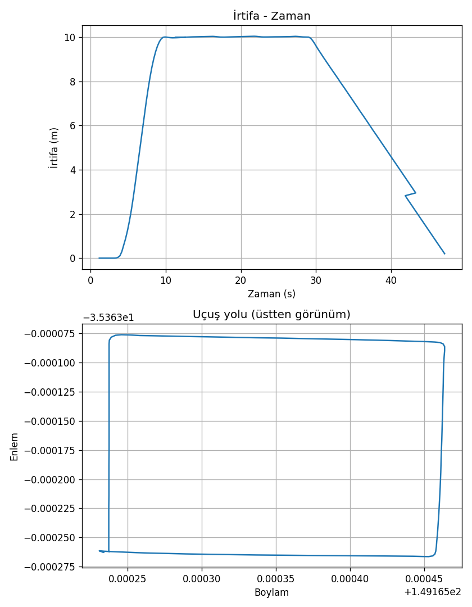

# Proje 1: İlk simülasyon uçuşum (ArduPilot SITL + Python)

Mahir Utku Karaosmanoğlu

## MAVLink nedir?
MAVLink, drone'lar ile yer istasyonları ve bilgisayar programları arasında mesaj taşıyan hafif bir iletişim protokolüdür. Konum, irtifa, mod gibi bilgiler ve "kalk", "şuraya git" gibi komutlar bu mesajlarla iletilir. Python'da `pymavlink` kütüphanesiyle bu mesajları okuyup gönderebiliriz.

## Kod ne yapıyor?
`kare_ucus.py` ArduPilot SITL'deki sanal İHA'ya MAVProxy üzerinden (UDP 14550) bağlanır. GUIDED moda geçip motorları açar ve 10 m'ye kalkar. Ardından 20 m kenarlı karenin 4 köşesine sırayla konum komutu gönderir; her köşede `LOCAL_POSITION_NED` mesajından anlık konumu okuyup hedefe 1 m'den yakın olunca sıradaki köşeye geçer. Son olarak LAND moduna geçip 0,3 m'nin altına inene kadar bekler. Uçuş boyunca `GLOBAL_POSITION_INT` mesajından zaman, enlem, boylam ve irtifa `ucus_kaydi.csv` dosyasına yazılır.

## Uçuş grafiği

Üstte irtifa-zaman, altta üstten görünüm uçuş yolu. İHA 10 m'de karenin 4 köşesini gezip inmiştir.

## Karşılaştığım sorun
MAVProxy’yi başlatınca [Errno 111] Connection refused hatası aldım. Nedeni, MAVProxy’nin bağlanmaya çalıştığı sanal İHA’nın (SITL) o anda çalışmıyor olmasıydı. SITL’i ayrı bir terminalde başlatıp “Waiting for connection” yazısını görünce MAVProxy’yi ikinci terminalde açtım ve bağlantı kuruldu.
